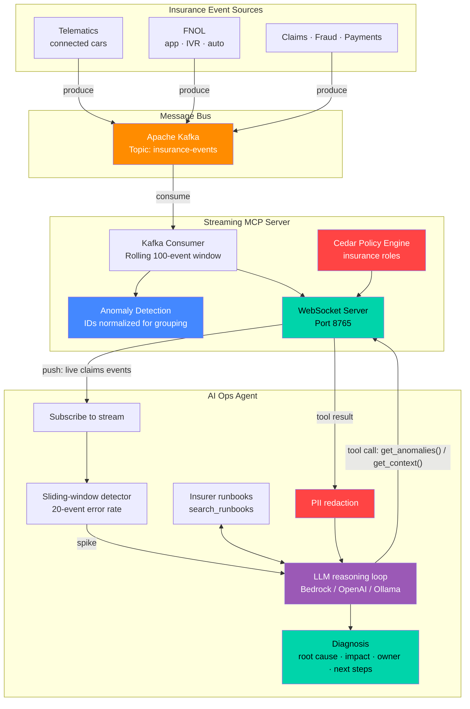
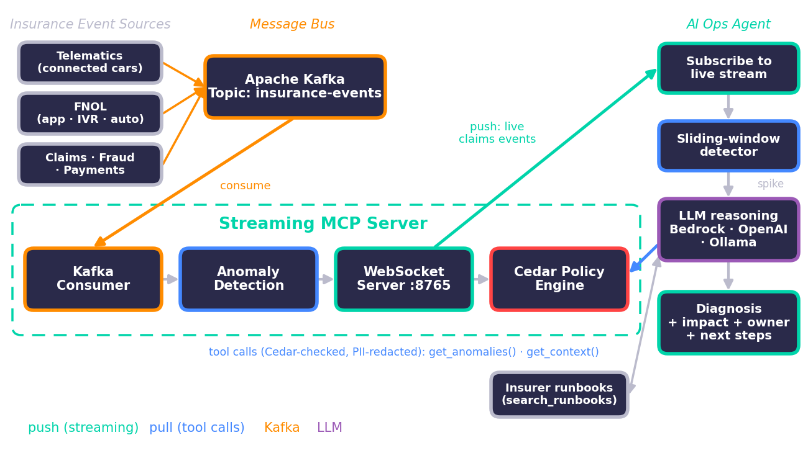

# MCP Live for Auto Insurance: Streaming Claims & Telematics Context to AI Agents

> **Branch `usecase/auto-insurance`** — the auto-insurance edition of [mcp-streaming-demo](https://github.com/hakohli/mcp-streaming-demo). The domain-neutral version (and the cross-industry overview) lives on [`main`](https://github.com/hakohli/mcp-streaming-demo/tree/main).

A working demo of **streaming MCP (Model Context Protocol)** for an auto insurer: live events from telematics, First Notice of Loss (FNOL), policy, claims, fraud-scoring and payments services are pushed through Kafka and WebSockets to an **LLM-driven operations agent**. When something goes wrong, the agent detects it in under a second and, within seconds, tells you the **root cause, the business impact on policyholders and claims SLAs, which team owns it, and what to do next** — while redacting PII and leaving every claim, coverage and fraud decision to people.

Providers: **Amazon Bedrock** (default), any **OpenAI-compatible** endpoint (OpenAI, Ollama, vLLM), or an offline **mock**. All data is synthetic.

## Contents

- [The Auto Insurance Use Case](#the-auto-insurance-use-case) · [Architecture](#architecture) · [What You'll See](#what-youll-see) · [Why It Matters for Auto Insurers](#why-it-matters-for-auto-insurers)
- [Project Structure](#project-structure) · [Quick Start](#quick-start--one-command-no-docker) · [Prerequisites](#prerequisites) · [Configure the LLM](#configure-the-llm)
- [Full Setup](#full-setup--real-kafka-separate-terminals) · [Tests](#tests) · [Environment Variables](#environment-variables) · [Troubleshooting](#troubleshooting)
- [Key Patterns](#key-patterns-demonstrated) · [Cedar Roles & Auth](#cedar-roles-and-authentication) · [Governance](#governance-privacy-and-compliance) · [Slide Deck](#slide-deck) · [FAQ](docs/FAQ.md)

## The Auto Insurance Use Case

The demo models the claims & telematics platform of a fictional auto insurer. Everything — services, scenarios, runbooks, roles and PII redaction — is defined in one place: [`mcp_streaming/domain/auto_insurance.py`](mcp_streaming/domain/auto_insurance.py).

### Platform services (event sources)

| Service | What it does |
|---------|--------------|
| `telematics-gateway` | Ingests connected-car and mobile-app trip data (usage-based insurance) |
| `crash-detection` | Scores telematics impact events and triggers automatic FNOL |
| `fnol-service` | First Notice of Loss intake — mobile app, phone/IVR, auto-FNOL |
| `policy-admin` | Policy and coverage verification |
| `claims-service` | Claim creation, adjuster assignment, estimates and workflow |
| `fraud-scoring` | ML fraud scoring and SIU referral |
| `rating-engine` | Usage-based-insurance premium rating |
| `payments-service` | Claim payouts and premium collection |

Each event carries `timestamp`, `level`, `service`, `event_type` (`telematics` · `fnol` · `policy` · `claim` · `fraud` · `rating` · `payment`), `region`, `message`, `request_id`, and — where relevant — `policy_id` / `claim_id`. Identifiers are synthetic (`POL-123456`, `CLM-654321`, `VEH-4821`). Events flow on the Kafka topic **`insurance-events`**.

### Incident scenarios

Every ~45 seconds the simulator replays one incident. Each scenario doubles as a **runbook** the LLM can search with the `search_runbooks` tool.

| Key (`--scenario`) | Type | What happens | Owner |
|--------------------|------|--------------|-------|
| `telematics_ingestion_outage` | platform | Telematics partition loses its leader → crash detection and auto-FNOL starve | Platform SRE |
| `policy_db_pool_exhausted` | platform | Policy DB connection pool exhausted → coverage checks time out, claims can't open | Platform SRE |
| `fraud_model_unavailable` | platform | Fraud model endpoint down → claims fall to manual review, payouts delayed | ML platform |
| `estimate_vendor_certificate` | third-party | Photo-estimate vendor certificate expired → field-appraiser fallback, higher LAE | Vendor management |
| `payout_batch_rejected` | platform | Bad payments deploy → bank rejects every ACH payout batch | Payments engineering |
| `catastrophe_fnol_surge` | business | Hailstorm drives FNOL 14× baseline in one region → SLAs at risk | CAT response |
| `staged_accident_ring` | fraud | Link analysis finds claims sharing a repair shop and contacts → SIU referral | SIU |

`--ai` lets the LLM invent new incidents (PII-redacted and validated before they enter the stream). `make scenarios` lists them.

### What the agent produces

For every spike the LLM investigates with four tools — `get_anomalies`, `get_context`, `search_runbooks`, `get_local_stats` — and returns a structured diagnosis:

| Field | Example |
|-------|---------|
| `severity` / `category` | `high` · `platform` \| `third-party` \| `business` \| `fraud` |
| `root_cause` | "payments-service v3.14.0 shipped an invalid bank originator configuration…" |
| `business_impact` | "Settled claims are not paid; prompt-payment compliance risk" |
| `recommended_owner` | `payments-eng` → *Payments engineering* |
| `remediation` | Ordered next steps, preferring the insurer's runbook |

In interactive mode you can ask *"Is FNOL healthy?"*, *"Any fraud alerts in the last few minutes?"*, *"Are payouts going out?"*, *"Which region is affected?"*.

### Guardrails built into the agent

- **Humans decide.** The agent recommends; it never approves, denies or closes a claim, changes coverage, or accuses a claimant. Fraud signals become *SIU referrals*, not conclusions.
- **PII redaction.** Emails, phone numbers, SSNs, VINs and card numbers are redacted from every event before it reaches the LLM.
- **Least privilege.** Cedar roles; the AI agent is explicitly **forbidden** from the raw `claimant-pii` stream.
- **Untrusted input.** Event content is treated as data; instructions inside events are ignored (prompt-injection defense). All tools are read-only.

## Architecture





## What You'll See

- Healthy traffic: trips ingested, FNOLs created, coverage verified, fraud scored, payouts issued
- About 10 seconds in (then every ~45s), an incident hits — e.g. a hailstorm surge or a fraud ring
- The agent detects the spike locally and hands it to the LLM
- The LLM pulls PII-redacted context and the matching runbook through MCP tool calls, then prints:

```
  🚨 Spike: 35% errors in last 20 events — 🧠 mock investigating...

  ┌─ 🧠 AI DIAGNOSIS ────────────────────────────────────────
  │ 🟡 Severity:   MEDIUM   (confidence 60%)   [fraud]
  │ 🎯 Root cause: Link analysis found a cluster of claims sharing a repair shop and contact details
  │               within 48h — a pattern consistent with an organized staged-accident ring
  │ 💼 Impact:     Potential claims leakage across the linked claims; legitimate claimants must not
  │               be delayed by false positives
  │ 👥 Owner:      Special Investigations Unit
  │ 🧩 Affected:   claims-service, fraud-scoring
  │ 🔧 Next steps:
  │    1. Refer the linked claims to SIU for investigation (a human decision — never auto-deny)
  │    2. Place a temporary payout hold on the linked claims, per SIU policy
  │    3. Preserve evidence: telematics, photos, repair invoices and call recordings
  │    4. Watch for new claims linked to the same repair shop
  │ ⚖️  Recommendations only — claim, coverage and fraud decisions stay with people.
  └──────────────────────────────────────────────────────────
```
*(Output from the offline `mock` provider, which answers from the runbooks; long lines wrapped for readability. A real LLM writes its own analysis.)*

## Why It Matters for Auto Insurers

### The problem
Claims and telematics platforms are usually watched through dashboards and batch reports. A hailstorm can multiply FNOL volume within minutes, a bad payments deploy can stop every payout, and a fraud ring can file a dozen linked claims in two days — yet these often surface in the next-morning report or in reconciliation days later. Pull-based AI agents that query snapshots inherit the same delay.

### What changes with streaming MCP + an LLM agent

| | Today | With this pattern |
|-|-------|-------------------|
| Detection | Batch reports, dashboards someone has to watch | Spike detected on the live stream in under a second |
| Diagnosis | Engineers and claims leads correlate logs across services by hand | LLM correlates services, separates root cause from symptoms, consults runbooks |
| Routing | Generic page to on-call | Named owner: SRE, payments, vendor management, CAT team or SIU |
| Business framing | Error codes | Impact on policyholders, claim SLAs, payouts and fraud exposure |
| Governance | Shared dashboards with raw data | Cedar roles, PII redaction, read-only agent, humans decide |

### Who benefits

- **Claims operations** — faster FNOL and claim acknowledgement; backlogs caught before SLAs slip
- **Special Investigations Unit** — ring signals summarized as they form, with evidence-preservation steps
- **Catastrophe response** — regional surges detected at onset, CAT plan recommended immediately
- **Payments & platform engineering** — failures tied to the deploy or dependency that caused them
- **Customer experience** — fewer delayed payouts and unexplained waits
- **Finance** — lower loss-adjustment expense (LAE) from vendor/estimate failures caught early; less leakage from earlier fraud signals

These are qualitative benefits; measure your own baseline (time to detect, cycle time, LAE, leakage) before and after a pilot.

## Project Structure

```
mcp-streaming-demo/
├── README.md                  ← you are here
├── Makefile                   ← short commands: `make help`
├── requirements.txt           ← pinned runtime dependencies
├── requirements-docs.txt      ← extra dependencies to rebuild the slide deck
├── docker-compose.yml         ← single-node Kafka (KRaft), published on 127.0.0.1:9092
│
├── mcp_streaming/             ← all application code (Python package)
│   ├── demo.py                ← one-process end-to-end demo (server + simulator + agent, mock Kafka)
│   ├── domain/
│   │   └── auto_insurance.py              ← services, events, 7 scenarios/runbooks, roles, PII redaction
│   ├── server/
│   │   ├── streaming_mcp_server.py        ← core streaming MCP server: Kafka consumer + WebSocket push
│   │   ├── streaming_mcp_server_cedar.py  ← same server with Cedar authorization
│   │   └── cedar_authz.py                 ← Cedar policies for the insurance roles
│   ├── agents/
│   │   ├── ai_agent.py                    ← LLM ops agent: autonomous diagnosis + interactive chat
│   │   ├── agent_client.py                ← rule-based baseline (no LLM)
│   │   └── agent_client_interactive.py    ← rule-based interactive baseline (no LLM)
│   ├── llm/
│   │   └── providers.py                   ← Bedrock / OpenAI-compatible / Ollama / mock + tool-calling loop
│   ├── simulator/
│   │   └── log_simulator.py               ← insurance events → Kafka; --scenario, --ai, --list-scenarios
│   └── messaging/
│       └── mock_kafka.py                  ← in-process drop-in for confluent_kafka
│
├── tests/
│   ├── test_auto_insurance.py ← scenarios, runbooks, redaction, Cedar roles, no-PII-to-LLM
│   ├── test_ai_agent.py       ← LLM layer + agent (mock LLM, fake Bedrock/OpenAI transports)
│   └── test_integration.py    ← Cedar server + mock Kafka over real WebSockets
│
└── docs/
    ├── FAQ.md                 ← 40 questions incl. an auto-insurance section
    └── presentation/
        ├── MCP_Live_Auto_Insurance.pptx   ← 18-slide deck for this use case
        ├── build_deck.py                  ← rebuilds the deck from the template
        ├── diagrams.py                    ← draws the deck's diagrams
        ├── images/                        ← generated diagrams (also used in this README)
        └── template/MCP_Live_Streaming_Context.pptx  ← original generic deck (build input)
```

All commands run **from the repository root**. Modules start with `python -m mcp_streaming.<area>.<module>`; every one also has a `make` shortcut.

## Quick Start — one command, no Docker

```bash
make install                 # creates .venv and installs requirements.txt
source .venv/bin/activate

make demo-offline            # offline smoke test with the mock LLM (40s)
make demo                    # real LLM (Bedrock by default — see "Configure the LLM")
make demo-chat               # interactive chat with the agent + LLM-generated incidents
make demo-scenario SCENARIO=catastrophe_fnol_surge   # show one specific incident
make scenarios               # list incident scenarios
```

Without `make`:
```bash
python3 -m venv .venv && source .venv/bin/activate && pip install -r requirements.txt
python -m mcp_streaming.demo --provider mock --duration 40
python -m mcp_streaming.demo
python -m mcp_streaming.demo --interactive --ai
python -m mcp_streaming.demo --scenario staged_accident_ring
```

`mcp_streaming.demo` runs the real MCP server, the insurance event simulator and the AI agent in one process, connected through the in-process mock Kafka and a loopback WebSocket. The first incident hits after ~10s (`--first-spike N`); `--duration N` stops after N seconds; `--scenario KEY` pins one incident. For the multi-process setup on real Kafka, follow **Full Setup** below.

## Prerequisites

| Tool | Version Tested | Purpose |
|------|---------------|---------|
| Python | 3.9+ | Runtime for all components |
| Docker | 29.3+ | Runs Kafka container (not needed for the one-process demo) |
| Apache Kafka | 7.6.0 (Confluent) | Durable event streaming bus |
| confluent-kafka (Python) | 2.13.2 | Kafka producer/consumer client |
| websockets (Python) | 15.0.1 | WebSocket server & client |
| boto3 (Python) | 1.42.97 | Amazon Bedrock client (default LLM provider) |
| Cedar | — | Authorization policy language (embedded) |
| LLM access | — | One of: Amazon Bedrock, OpenAI-compatible API, local Ollama — or `mock` for none |
| make | any | Optional shortcuts (preinstalled on macOS/Linux) |

## Configure the LLM

| Provider | Setup |
|----------|-------|
| `bedrock` (default) | AWS credentials in the standard chain with `bedrock:InvokeModel` on the model, and model access enabled in the Bedrock console. Optional: `AWS_REGION` (default `us-east-1`), `BEDROCK_MODEL_ID` (default `us.anthropic.claude-3-5-haiku-20241022-v1:0`). |
| `openai` | `OPENAI_API_KEY`, optional `OPENAI_MODEL` (default `gpt-4o-mini`), `OPENAI_BASE_URL`. |
| `ollama` | Local Ollama running; optional `OPENAI_MODEL` (default `llama3.1`). The model must support tool calling. Useful when claims data must stay on-premises. |
| `mock` | Nothing — offline stand-in that answers from the runbooks; good for tests and dry runs. |

```bash
export LLM_PROVIDER=bedrock   # or openai | ollama | mock
export AWS_REGION=us-east-1   # bedrock only
```
Every LLM-aware command also accepts `--provider`. Quick check that your LLM access works:
```bash
python -c "import asyncio; from mcp_streaming.llm import create_llm; print(asyncio.run(create_llm().new_conversation('Be brief.').ask('Say OK', None)))"
```

## Full Setup — real Kafka, separate terminals

Run each step in its own terminal, from the repository root, with the virtualenv activated (`source .venv/bin/activate`).

| Step | `make` | Command | What it does |
|------|--------|---------|--------------|
| 1 | `make kafka-up` | `docker compose up -d` | Starts Kafka on `127.0.0.1:9092`. Wait ~15s for KRaft startup. |
| 2 | `make server` | `python -m mcp_streaming.server.streaming_mcp_server` | Streaming MCP server on `ws://127.0.0.1:8765`, topic `insurance-events` |
| 3 | `make simulator` / `make simulator-ai` | `python -m mcp_streaming.simulator.log_simulator [--ai \| --scenario KEY]` | Insurance events every second; an incident every ~45s |
| 4 | `make agent` / `make agent-chat` | `python -m mcp_streaming.agents.ai_agent [--interactive]` | LLM ops agent subscribes, detects, diagnoses |

**Step 2 — server.** You should see `Streaming MCP Server running on ws://127.0.0.1:8765`. The server has no authentication, so it binds to loopback by default (`MCP_HOST` / `MCP_PORT` override it — only widen the bind behind a gateway that authenticates callers).

**Step 3 — simulator.** By default it rotates through all seven scenarios. `--scenario KEY` pins one; `--ai` lets the LLM invent a new, causally ordered incident each time (falls back to built-in scenarios if the LLM is unavailable); `--list-scenarios` prints them.

**Step 4 — AI agent.** Flags: `--provider`, `--threshold 0.3`, `--window 20`, `--cooldown 30` (min seconds between LLM calls — keeps cost flat during a CAT surge), `--show all|errors|none`, `--uri ws://127.0.0.1:8765`, `--auth-role ai-agent` (Cedar server only).

### Optional variants

**Cedar-authorized server** — use instead of step 2 to enforce the insurance roles (see [Cedar roles](#cedar-roles-and-authentication)). It uses mock Kafka unless `USE_REAL_KAFKA=1` is set:
```bash
USE_REAL_KAFKA=1 MCP_AUTH_TEST_BYPASS=1 python -m mcp_streaming.server.streaming_mcp_server_cedar
python -m mcp_streaming.agents.ai_agent --auth-role ai-agent
```

**Rule-based agents (no LLM baseline)** — use instead of step 4; they print the first step of the matching runbook:
```bash
python -m mcp_streaming.agents.agent_client
python -m mcp_streaming.agents.agent_client_interactive   # commands: anomalies | context | status | help | quit
```

**Everything in one terminal (tmux)** — with Kafka running and the venv activated:
```bash
tmux new-session -s mcp -d 'make server' \; \
  split-window -h 'sleep 2 && make simulator-ai' \; \
  split-window -v 'sleep 4 && make agent-chat' \; \
  attach
```

If output appears delayed, prefix commands with `PYTHONUNBUFFERED=1` (the `make` targets already set it).

## Tests

```bash
make test                                          # all 29 tests — no Docker, no LLM, no network
python -m unittest discover -s tests -t . -v       # same, without make
python -m unittest tests.test_auto_insurance -v    # use-case: scenarios, runbooks, redaction, roles
python -m unittest tests.test_ai_agent -v          # LLM layer + agent
python -m unittest tests.test_integration -v       # Cedar server + mock Kafka
make demo-offline                                  # end-to-end smoke test
```

The use-case tests check, among other things, that every scenario's error lines map back to their own runbook, that healthy traffic matches none, that PII never reaches the LLM through any tool, and that the mock diagnoses every scenario with the right owner.

## Environment Variables

| Variable | Default | Used by | Purpose |
|----------|---------|---------|---------|
| `LLM_PROVIDER` | `bedrock` | agent, simulator `--ai`, demo | `bedrock` \| `openai` \| `ollama` \| `mock` |
| `AWS_REGION` | `us-east-1` | bedrock | Bedrock region |
| `BEDROCK_MODEL_ID` | `us.anthropic.claude-3-5-haiku-20241022-v1:0` | bedrock | Model / inference profile |
| `OPENAI_API_KEY` | — | openai | API key (omit for local servers) |
| `OPENAI_BASE_URL` | `https://api.openai.com/v1` (`http://127.0.0.1:11434/v1` for ollama) | openai, ollama | Endpoint |
| `OPENAI_MODEL` | `gpt-4o-mini` (`llama3.1` for ollama) | openai, ollama | Model name |
| `KAFKA_TOPIC` | `insurance-events` | servers, simulator, agents | Event topic / stream name (the Cedar policies name `insurance-events` — update them if you change it) |
| `MCP_HOST` / `MCP_PORT` | `127.0.0.1` / `8765` | servers | WebSocket bind address |
| `USE_MOCK_KAFKA` | unset | `streaming_mcp_server`, `log_simulator` | `1` = in-process mock Kafka (set automatically by `mcp_streaming.demo`) |
| `USE_REAL_KAFKA` | unset | `streaming_mcp_server_cedar` | `1` = real Kafka (default is mock) |
| `MCP_AUTH_TEST_BYPASS` | unset | `streaming_mcp_server_cedar` | `1` = accept client-asserted roles (local demos/tests only) |

## Troubleshooting

| Symptom | Fix |
|---------|-----|
| `ModuleNotFoundError: No module named 'mcp_streaming'` | Run commands from the repository root (the folder containing `mcp_streaming/`). |
| `LLM setup failed` / `Bedrock converse failed: ... AccessDeniedException` | Credentials lack `bedrock:InvokeModel`, or model access isn't enabled for that model in the Bedrock console/region. |
| `Bedrock converse failed: ... ValidationException ... inference profile` | Use an inference-profile ID (`us.` prefix) or a model available in your `AWS_REGION`. |
| `Diagnosis failed: request to http://127.0.0.1:11434/v1 failed` | Ollama isn't running (`ollama serve`), or the model isn't pulled (`ollama pull llama3.1`). |
| Agent prints events but never diagnoses | The error rate must exceed `--threshold` over a full `--window`; diagnoses are rate-limited by `--cooldown`. |
| `invalid choice` for `--scenario` | Run `make scenarios` for the valid keys. |
| `Connect to ipv4#127.0.0.1:9092 failed` | Kafka isn't up — `make kafka-up`, or use the one-process demo (`make demo`) instead. |
| `subscribe failed: ... FORBIDDEN` / `UNAUTHENTICATED` | Cedar server — see the roles section below. |

## Key Patterns Demonstrated

1. **Event subscription** — the agent subscribes once to `insurance-events` and gets continuous updates
2. **Hybrid protocol** — streaming + request/response (`get_anomalies`, `get_context`) on the same WebSocket
3. **Sliding-window anomaly detection** — server tracks a rolling 100-event window and groups errors by signature (IDs normalized, so `CLM-136213` and `CLM-383083` count together); agent triggers at >30% error rate
4. **LLM-driven diagnosis** — a cheap local detector decides *when* to think; the LLM decides *what* is wrong, using MCP tools plus the insurer's runbooks, and returns structured JSON with business impact and owner. Cooldown bounds LLM cost.
5. **Technical vs business anomalies** — the agent separates outages and bad deploys from catastrophe surges and fraud rings, because they need different owners
6. **PII redaction before the LLM** — applied to every tool result and prompt
7. **Backpressure handling** — bounded 500-event queues per subscriber; slow consumers are dropped
8. **Cedar authorization** — least-privilege insurance roles; denials come back to the LLM as tool errors it reasons around
9. **Kafka as durable event bus** — replayable, decoupled, scalable; consumer groups for load balancing or fan-out

## Cedar Roles and Authentication

Policies live in [`mcp_streaming/server/cedar_authz.py`](mcp_streaming/server/cedar_authz.py):

| Role | subscribe `insurance-events` | `get_anomalies` | `get_context` | subscribe `claimant-pii` |
|------|:---:|:---:|:---:|:---:|
| `ai-agent` (the LLM agent) | ✅ | ✅ | ✅ (PII redacted by the agent) | ❌ **forbid** |
| `claims-ops` | ✅ | ✅ | ❌ | ❌ |
| `siu-analyst` | ✅ | ❌ | ✅ | ❌ |
| `viewer` (unauthenticated default) | ✅ | ❌ | ❌ | ❌ |

Default deny; a matching `forbid` always wins. See the decisions with `python -m mcp_streaming.server.cedar_authz`.

Roles must come from a credential the server can **verify** — `verify_principal()` in `streaming_mcp_server_cedar.py` is a fail-closed stub that rejects every `auth` message until you wire a real verifier (for example, a JWT validated against your identity provider's JWKS, with the role taken from its claims). Until then every connection is the anonymous `viewer`. For local demos and tests only, `MCP_AUTH_TEST_BYPASS=1` accepts the client-asserted role:
```bash
MCP_AUTH_TEST_BYPASS=1 python -m mcp_streaming.server.streaming_mcp_server_cedar
python -m mcp_streaming.agents.ai_agent --auth-role ai-agent
```

## Governance, Privacy and Compliance

This repository is a **reference implementation on synthetic data**, not a production system. Before using the pattern with real claims or telematics data, work with your security, privacy and compliance teams on at least:

- **Real authentication** in place of the fail-closed stub, and production-grade Cedar via the official SDK
- **Data protection** — policyholder and claimant PII, driving/location data and payment data are sensitive; extend the redaction rules to your data, and keep raw PII streams out of the agent's reach (as the `claimant-pii` forbid does)
- **Regulatory obligations** — for example state claim-handling and prompt-payment timelines, GLBA and state privacy laws, and AI governance expectations such as the NAIC Model Bulletin on the Use of AI Systems by Insurers. This README is not legal advice.
- **Human oversight** — keep the agent read-only; any action that changes a claim, payment or policy should go through people and your existing approval workflows
- **Model risk management** — evaluate diagnosis accuracy, false positives and bias; log prompts, tool calls and outputs for audit
- **Data boundaries** — choose model hosting that fits: Amazon Bedrock in your region, or self-hosted models (Ollama / vLLM)

## Slide Deck

[`docs/presentation/MCP_Live_Auto_Insurance.pptx`](docs/presentation/MCP_Live_Auto_Insurance.pptx) — 18 slides: the stale-context problem in claims, architecture, protocol, Cedar insurance roles, live demo, AI diagnosis flow, **auto-insurance use cases, the demo's incident scenarios, an example AI diagnosis, why it matters for insurers, and governance & compliance**, plus takeaways.

The deck is generated, so it stays in sync with the code (the scenario slide is built from `domain/auto_insurance.py`):
```bash
pip install -r requirements-docs.txt
make deck            # = python docs/presentation/build_deck.py
```

## More Documentation

- [docs/FAQ.md](docs/FAQ.md) — 40 questions, including an auto-insurance section
- [`main` branch](https://github.com/hakohli/mcp-streaming-demo/tree/main) — the domain-neutral version and the cross-industry "Why This Matters" overview

## Teardown

```bash
# Stop Python processes (Ctrl+C in each terminal also works)
pkill -f "mcp_streaming\."

# Stop Kafka
make kafka-down              # or: docker compose down -v
```

## License

All open source: Apache Kafka, Cedar, WebSockets, Python. LLM providers (Amazon Bedrock, OpenAI, Ollama) are used under their own terms. All insurance data in this repository is synthetic.
