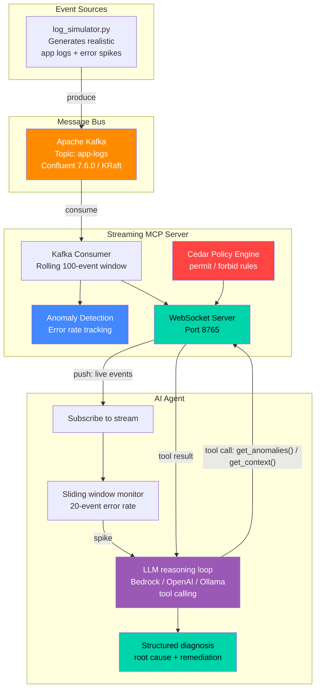

# MCP Live: Streaming Context to AI Agents

A working demo of **streaming MCP (Model Context Protocol)** — pushing real-time context to AI agents using Kafka, WebSockets, and Cedar authorization.

Instead of the traditional request/response MCP model where agents poll for stale snapshots, this demo shows agents receiving live events as they happen, detecting anomalies in under 1 second, and suggesting fixes automatically.

**AI-driven:** an LLM agent (`ai_agent.py`) investigates every spike on its own — it calls the server's MCP methods as tools, correlates errors across services, and returns a structured diagnosis (severity, root cause, affected services, remediation). You can also chat with it while the stream runs, and the log simulator can let an LLM invent realistic incident scenarios. Providers: **Amazon Bedrock** (default), any **OpenAI-compatible** endpoint (OpenAI, Ollama, vLLM), or an offline **mock**.

## Architecture



### Data Flow

```
log_simulator.py [--ai] → Kafka (app-logs) → streaming_mcp_server.py → ai_agent.py ⇄ LLM
                                                       ↕ WebSocket          (tool calls)
                                                 subscribe / get_anomalies / get_context
```

## What You'll See

- Normal log traffic flowing through the agent in real-time
- Every ~30 seconds, an error spike hits
- The agent detects the spike locally, then hands it to the LLM
- The LLM pulls context from the server through MCP tool calls (hybrid protocol) and prints an AI diagnosis
- In interactive mode you can ask "what's failing right now?" and get answers grounded in live data

## Quick Start — one command, no Docker

```bash
python3 -m venv .venv && source .venv/bin/activate
pip install -r requirements.txt

python run_demo.py --provider mock --duration 40   # offline smoke test, no LLM needed
python run_demo.py                                 # real LLM (Bedrock by default — see "Configure the LLM")
python run_demo.py --interactive --ai              # chat with the agent + LLM-generated incidents
```

`run_demo.py` runs the real MCP server, log simulator and AI agent in one process, connected through the in-process mock Kafka and a loopback WebSocket. The first spike hits after ~10s (`--first-spike N`). For the full multi-process setup on real Kafka, follow **Full Setup** below.

## Prerequisites

| Tool | Version Tested | Purpose |
|------|---------------|---------|
| Python | 3.9+ | Runtime for all components |
| Docker | 29.3+ | Runs Kafka container (not needed for `run_demo.py`) |
| Apache Kafka | 7.6.0 (Confluent) | Durable event streaming bus |
| confluent-kafka (Python) | 2.13.2 | Kafka producer/consumer client |
| websockets (Python) | 15.0.1 | WebSocket server & client |
| Cedar | — | Authorization policy language (embedded) |
| boto3 (Python) | 1.42.97 | Amazon Bedrock client (default LLM provider) |
| LLM access | — | One of: Amazon Bedrock, OpenAI-compatible API, local Ollama — or `mock` for none |

## Full Setup — real Kafka, separate terminals (run in order)

### 1. Start Kafka
```bash
docker compose up -d
```
Wait ~15 seconds for Kafka to fully initialize (KRaft controller election + broker startup). The broker is published on `127.0.0.1:9092` only — it has no authentication.

### 2. Install dependencies
```bash
python3 -m venv .venv && source .venv/bin/activate
pip install -r requirements.txt
```

Every terminal below needs the virtualenv activated (`source .venv/bin/activate`).

### 2b. Configure the LLM
| Provider | Setup |
|----------|-------|
| `bedrock` (default) | AWS credentials in the standard chain with `bedrock:InvokeModel` on the model, and model access enabled in the Bedrock console. Optional: `AWS_REGION` (default `us-east-1`), `BEDROCK_MODEL_ID` (default `us.anthropic.claude-3-5-haiku-20241022-v1:0`). |
| `openai` | `OPENAI_API_KEY`, optional `OPENAI_MODEL` (default `gpt-4o-mini`), `OPENAI_BASE_URL`. |
| `ollama` | Local Ollama running; optional `OPENAI_MODEL` (default `llama3.1`). The model must support tool calling. |
| `mock` | Nothing — offline rule-based stand-in, good for tests and dry runs. |

```bash
export LLM_PROVIDER=bedrock   # or openai | ollama | mock
export AWS_REGION=us-east-1   # bedrock only
```
Every LLM-aware command also accepts `--provider` to override `LLM_PROVIDER`. Quick check that Bedrock access works:
```bash
python -c "import asyncio, llm; c=llm.create_llm().new_conversation('Be brief.'); print(asyncio.run(c.ask('Say OK', None)))"
```

### 3. Start the Streaming MCP Server
```bash
python streaming_mcp_server.py
```
You should see: `Streaming MCP Server running on ws://127.0.0.1:8765`

The server has no authentication, so it binds to loopback by default (`MCP_HOST` / `MCP_PORT` override it — only widen the bind behind a gateway that authenticates callers).

### 4. Start the Log Simulator (separate terminal)
```bash
python log_simulator.py
```
This produces realistic application logs to Kafka every second. Add `--ai` to have the LLM invent a new, causally coherent incident (root-cause service fails first, downstream services follow) for each spike:
```bash
python log_simulator.py --ai
```

### 5. Start the AI Agent (separate terminal)
```bash
python ai_agent.py                # autonomous LLM monitor
python ai_agent.py --interactive  # monitor + chat with the agent
```
The agent subscribes to the live stream; on each spike the LLM investigates and prints a diagnosis like:
```
  🚨 Spike: 35% errors in last 20 events — 🧠 bedrock:... investigating...

  ┌─ 🧠 AI DIAGNOSIS ────────────────────────────────────────
  │ 🔴 Severity:   CRITICAL   (confidence 80%)
  │ 🎯 Root cause: inventory-db refusing connections; order/payment timeouts are downstream symptoms
  │ 🧩 Affected:   inventory-db, order-service, payment-service
  │ 🔧 Remediation:
  │    1. ...
```
Useful flags: `--provider`, `--threshold 0.3`, `--window 20`, `--cooldown 30` (min seconds between LLM calls, controls cost), `--show all|errors|none`.

In interactive mode ask things like *"what is failing right now?"*, *"is payment-service healthy?"*, *"what should I do first?"* — the LLM answers using live `get_anomalies` / `get_context` tool calls and remembers the conversation. `status` and `quit` are built in.

The original rule-based agents (`agent_client.py`, `agent_client_interactive.py`) still work as a non-LLM baseline.

### 5b. Cedar-authorized server (optional)
Use `streaming_mcp_server_cedar.py` in step 3 instead to enforce Cedar policies — see [Cedar server and authentication](#cedar-server-and-authentication). It uses mock Kafka unless `USE_REAL_KAFKA=1` is set.

### 5c. Rule-based Interactive Agent (no LLM)
```bash
python agent_client_interactive.py
```
You can type commands while events stream:
- `anomalies` — query the server for anomaly summary
- `context` — get current server context
- `status` — show local event count and error window
- `help` — list commands
- `quit` — exit

### Full Setup in one terminal (tmux)
With Kafka running and the venv activated, start all three components in split panes:
```bash
tmux new-session -s mcp -d 'PYTHONUNBUFFERED=1 python3 streaming_mcp_server.py' \; \
  split-window -h 'sleep 2 && PYTHONUNBUFFERED=1 python3 log_simulator.py --ai' \; \
  split-window -v 'sleep 4 && PYTHONUNBUFFERED=1 python3 ai_agent.py --interactive' \; \
  attach
```

### Tip: Unbuffered Output
If output appears delayed, use `PYTHONUNBUFFERED=1`:
```bash
PYTHONUNBUFFERED=1 python ai_agent.py
```

## Environment Variables

| Variable | Default | Used by | Purpose |
|----------|---------|---------|---------|
| `LLM_PROVIDER` | `bedrock` | agent, simulator `--ai`, `run_demo.py` | `bedrock` \| `openai` \| `ollama` \| `mock` |
| `AWS_REGION` | `us-east-1` | bedrock | Bedrock region |
| `BEDROCK_MODEL_ID` | `us.anthropic.claude-3-5-haiku-20241022-v1:0` | bedrock | Model / inference profile |
| `OPENAI_API_KEY` | — | openai | API key (omit for local servers) |
| `OPENAI_BASE_URL` | `https://api.openai.com/v1` (`http://127.0.0.1:11434/v1` for ollama) | openai, ollama | Endpoint |
| `OPENAI_MODEL` | `gpt-4o-mini` (`llama3.1` for ollama) | openai, ollama | Model name |
| `MCP_HOST` / `MCP_PORT` | `127.0.0.1` / `8765` | servers | WebSocket bind address |
| `USE_MOCK_KAFKA` | unset | `streaming_mcp_server.py`, `log_simulator.py` | `1` = in-process mock Kafka (set automatically by `run_demo.py`) |
| `USE_REAL_KAFKA` | unset | `streaming_mcp_server_cedar.py` | `1` = real Kafka (default is mock) |
| `MCP_AUTH_TEST_BYPASS` | unset | `streaming_mcp_server_cedar.py` | `1` = accept client-asserted roles (local demos/tests only) |

## Troubleshooting

| Symptom | Fix |
|---------|-----|
| `LLM setup failed` / `Bedrock converse failed: ... AccessDeniedException` | Credentials lack `bedrock:InvokeModel`, or model access isn't enabled for that model in the Bedrock console/region. |
| `Bedrock converse failed: ... ValidationException ... inference profile` | Use an inference-profile ID (`us.` prefix) or a model available in your `AWS_REGION`. |
| `Diagnosis failed: request to http://127.0.0.1:11434/v1 failed` | Ollama isn't running (`ollama serve`), or the model isn't pulled (`ollama pull llama3.1`). |
| Agent prints events but never diagnoses | The error rate must exceed `--threshold` over a full `--window`; diagnoses are rate-limited by `--cooldown`. |
| `Connect to ipv4#127.0.0.1:9092 failed` | Kafka isn't up — `docker compose up -d`, or use `run_demo.py` instead. |
| `subscribe failed: ... FORBIDDEN` / `UNAUTHENTICATED` | Cedar server — see the authentication section below. |

## Key Patterns Demonstrated

1. **Event subscription** — agent subscribes once, gets continuous updates via `subscribe` / `unsubscribe`
2. **Hybrid protocol** — streaming + request/response (`get_anomalies`, `get_context`) on same WebSocket
3. **Sliding window anomaly detection** — server tracks error rates in a rolling 100-event buffer; agent triggers at >30% error rate
4. **LLM-driven diagnosis** — a cheap local detector decides *when* to think; the LLM decides *what* is wrong by calling MCP methods as tools, then returns structured JSON (severity, root cause, affected services, remediation). Cooldown bounds LLM cost. Log content is treated as untrusted input in the system prompt, and the LLM's tools are read-only.
5. **Backpressure handling** — bounded 500-event queues per subscriber; slow consumers are dropped
6. **Cedar authorization** — declarative permit/forbid policies controlling which agents can subscribe to which streams. Denials come back to the LLM as tool errors it reasons around.
7. **Kafka as durable event bus** — replayable, decoupled, scalable; consumer groups for load balancing or fan-out

## Files

| File | Description |
|------|-------------|
| `streaming_mcp_server.py` | Core streaming MCP server — Kafka consumer + WebSocket push |
| `streaming_mcp_server_cedar.py` | Server variant with Cedar authorization |
| `run_demo.py` | **One-command end-to-end demo** — server + simulator + agent in one process on mock Kafka |
| `ai_agent.py` | **LLM agent** — autonomous spike investigation + interactive chat, MCP methods as LLM tools |
| `llm.py` | LLM provider layer (Bedrock Converse, OpenAI-compatible, mock) with a tool-calling loop |
| `agent_client.py` | Rule-based agent (no LLM baseline) |
| `agent_client_interactive.py` | Rule-based interactive agent (no LLM baseline) |
| `log_simulator.py` | Produces log events to Kafka; `--ai` for LLM-generated incidents |
| `cedar_authz.py` | Cedar policy engine for MCP action authorization |
| `mock_kafka.py` | In-process mock Kafka for testing without Docker |
| `test_integration.py` | Integration tests (Cedar server + mock Kafka) |
| `test_ai_agent.py` | LLM/agent tests — offline (mock LLM, fake Bedrock/OpenAI transports) |
| `docker-compose.yml` | Kafka (Confluent cp-kafka 7.6.0, KRaft mode) |

## Tests

```bash
python -m unittest test_ai_agent -v                  # no Docker, no LLM, no network
python test_integration.py                           # Cedar server + mock Kafka
python run_demo.py --provider mock --duration 40     # end-to-end smoke test
```

## Cedar server and authentication

`streaming_mcp_server_cedar.py` evaluates Cedar policies against the connection's principal. Roles must come from a credential the server can **verify** — `verify_principal()` is a fail-closed stub that rejects every `auth` message until you wire a real verifier (for example, a JWT validated against your identity provider's JWKS, with the role taken from its claims). Until then every connection is the anonymous `viewer`.

For local demos and tests only, `MCP_AUTH_TEST_BYPASS=1` accepts the client-asserted principal:
```bash
MCP_AUTH_TEST_BYPASS=1 python streaming_mcp_server_cedar.py
python ai_agent.py --auth-role ops-agent
```

## Teardown

```bash
# Stop Python processes
pkill -f "streaming_mcp_server.py"
pkill -f "log_simulator.py"
pkill -f "agent_client.py"
pkill -f "ai_agent.py"
pkill -f "run_demo.py"

# Stop Kafka
docker compose down -v
```

## License

All open source: Apache Kafka, Cedar, WebSockets, Python. LLM providers (Amazon Bedrock, OpenAI, Ollama) are used under their own terms.
