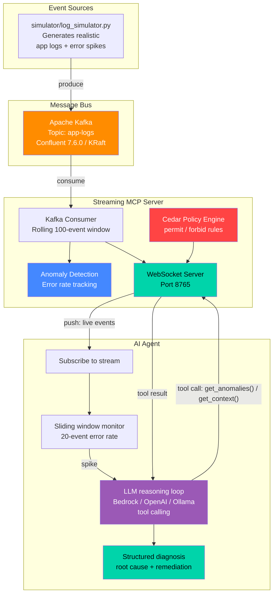

# MCP Live: Streaming Context to AI Agents

A working demo of **streaming MCP (Model Context Protocol)** — pushing real-time context to AI agents using Kafka, WebSockets, and Cedar authorization.

Instead of the traditional request/response MCP model where agents poll for stale snapshots, this demo shows agents receiving live events as they happen, detecting anomalies in under 1 second, and suggesting fixes automatically.

**AI-driven:** an LLM agent (`mcp_streaming/agents/ai_agent.py`) investigates every spike on its own — it calls the server's MCP methods as tools, correlates errors across services, and returns a structured diagnosis (severity, root cause, affected services, remediation). You can also chat with it while the stream runs, and the log simulator can let an LLM invent realistic incident scenarios. Providers: **Amazon Bedrock** (default), any **OpenAI-compatible** endpoint (OpenAI, Ollama, vLLM), or an offline **mock**.

## Contents

- [Architecture](#architecture) · [What You'll See](#what-youll-see) · [Why This Matters](#why-this-matters) · [**Use Cases**](#use-cases)
- [Project Structure](#project-structure) · [Quick Start](#quick-start--one-command-no-docker) · [Prerequisites](#prerequisites) · [Configure the LLM](#configure-the-llm)
- [Full Setup](#full-setup--real-kafka-separate-terminals) · [Tests](#tests) · [Environment Variables](#environment-variables) · [Troubleshooting](#troubleshooting)
- [Key Patterns](#key-patterns-demonstrated) · [Cedar & Auth](#cedar-server-and-authentication) · [FAQ](docs/FAQ.md) · [Teardown](#teardown)

## Architecture



### Data Flow

```
simulator/log_simulator [--ai] → Kafka (app-logs) → server/streaming_mcp_server → agents/ai_agent ⇄ LLM
                                                              ↕ WebSocket            (tool calls)
                                                     subscribe / get_anomalies / get_context
```

## What You'll See

- Normal log traffic flowing through the agent in real-time
- Every ~30 seconds, an error spike hits
- The agent detects the spike locally, then hands it to the LLM
- The LLM pulls context from the server through MCP tool calls (hybrid protocol) and prints an AI diagnosis
- In interactive mode you can ask "what's failing right now?" and get answers grounded in live data

## Why This Matters

### The problem with today's AI agents
Most AI agents — and the Model Context Protocol in its common form — are **pull-based**: the agent asks for context, gets a snapshot, and reasons over it. That works for documents and databases, but not for systems that change every second. By the time a polling agent sees a failure, the snapshot is stale, the incident has spread, and a human has usually already been paged.

### What this project demonstrates
This project shows a different pattern: **streaming context into an LLM agent**, so the agent works from a live picture of the system instead of a stale snapshot.

| Shift | From | To |
|-------|------|----|
| Context delivery | Agent polls for snapshots | Events are **pushed** to the agent as they happen |
| Detection | Static thresholds and dashboards a human watches | Agent detects anomalies in under a second, on the live stream |
| Diagnosis | Engineer correlates logs across services by hand | LLM **investigates autonomously** — pulls more context through MCP tool calls, separates root cause from symptoms |
| Remediation | Runbook lookup | Structured, ordered remediation steps produced in seconds |
| Governance | Shared credentials, all-or-nothing access | **Policy-controlled** access (Cedar) per agent role, per stream, per action |
| Coupling | Point-to-point integrations | **Kafka** as a durable, replayable, fan-out event backbone |

### Why it's significant
- **It extends MCP from request/response to real-time streaming.** The same WebSocket carries both the push stream and on-demand tool calls (the "hybrid protocol"), so agents get freshness *and* depth without separate channels.
- **It puts the LLM in the right place.** A cheap, deterministic detector decides *when* to think; the LLM decides *what* is wrong. This keeps LLM cost and latency off the hot path — the pattern that makes AI viable on high-volume streams.
- **It treats safety and governance as part of the design, not an afterthought.** Read-only tools, untrusted-input handling against prompt injection from log content, fail-closed authentication, policy-as-code authorization, and loopback-by-default networking are what regulated industries need before they let an agent near production data.
- **It is vendor-neutral and portable.** Swap the LLM (Bedrock, OpenAI, Ollama/on-prem), swap the event source (anything that writes JSON to Kafka), and the architecture holds — including fully on-premises deployments for data-sovereignty requirements.
- **It shortens the gap between "something broke" and "here's what to do"** from minutes or hours to seconds, which translates directly into lower downtime cost, fewer customers affected, and less on-call fatigue.

### Sectors and use cases

| Sector | Example streaming sources | What an AI streaming agent can do |
|--------|---------------------------|-----------------------------------|
| **Automotive & connected vehicles** | Vehicle telemetry (CAN bus, OBD-II), OTA update logs, EV charging networks, factory line sensors | Detect fleet-wide fault patterns after an OTA release and recommend a rollback; diagnose charging-station outages; flag predictive-maintenance issues before breakdowns |
| **Auto insurance** — [implemented ↗](use-cases/auto-insurance/) | Telematics / usage-based-insurance (UBI) feeds, crash-detection events, first-notice-of-loss (FNOL) intake, claims systems | Trigger instant FNOL from crash telemetry; spot staged-accident or claims-fraud patterns as they emerge; monitor UBI pipelines so pricing data isn't silently lost |
| **Health insurance** | Claims adjudication streams, eligibility/prior-authorization APIs, provider network systems, member portals | Detect claims-processing backlogs or denial-rate spikes in real time; flag anomalous billing patterns (upcoding, duplicate claims) for investigators; keep prior-auth systems within regulatory turnaround times |
| **Healthcare & life sciences** | Patient monitoring devices, EHR integration (HL7/FHIR) feeds, lab systems, pharmacy and supply systems | Catch failed HL7/FHIR interfaces before results go missing; correlate device alarms; monitor cold-chain for vaccines and biologics — with a human always in the loop for clinical decisions |
| **Banking & financial services** | Payment rails, card authorizations, trading platforms, core-banking logs, market data | Detect payment failures or authorization-decline spikes within seconds; real-time fraud and AML signal triage; diagnose trading-system latency before it affects order execution |
| **Telecommunications** | Network element logs, 5G core / RAN telemetry, CDRs, OSS/BSS events | Correlate alarm storms to a single root-cause node; predict cell-site or fiber outages; diagnose provisioning failures and dropped-call spikes; support autonomous-network (zero-touch) operations |
| **Energy & utilities** | Smart meters, SCADA/grid telemetry, substation sensors, renewable generation feeds | Detect grid anomalies and equipment degradation early; diagnose smart-meter data-collection failures; support outage response by correlating field events |
| **Manufacturing & Industry 4.0** | PLC/IoT sensor streams, MES logs, quality-inspection systems | Identify the upstream machine causing a quality defect; predictive maintenance; reduce unplanned line downtime |
| **Retail & e-commerce** | Checkout and payment services, inventory systems, clickstream, POS | Catch checkout failures during peak events (e.g., flash sales) before revenue is lost; detect inventory-sync drift between stores and online |
| **Logistics & supply chain** | Fleet GPS, warehouse robotics, shipment tracking, EDI feeds | Detect routing or scanning failures; diagnose warehouse automation stoppages; proactively flag shipments at risk of SLA breach |
| **Cybersecurity (SOC)** | SIEM events, firewall/IDS logs, authentication logs, EDR telemetry | Triage alert floods, correlate multi-stage attacks, and draft incident summaries for analysts — reducing mean time to detect and respond |
| **Cloud, SaaS & DevOps / SRE** | Application logs, deployment events, metrics, traces | Autonomous incident triage (this demo's core scenario); link a spike to the deployment that caused it; draft post-incident timelines |
| **Aviation & transportation** | Aircraft health monitoring, airport operations systems, rail signalling | Early detection of component degradation; diagnose baggage, check-in, or signalling system failures that cascade into delays |
| **Public sector & emergency services** | 911/CAD dispatch systems, traffic sensors, public-service portals | Keep critical citizen-facing systems available; correlate sensor events during emergencies to support responders |
| **Media, gaming & streaming** | CDN logs, game-server telemetry, video-player QoE metrics | Detect buffering or matchmaking failures during live events; pinpoint the region or CDN edge at fault |

### Adoption considerations
This repository is a **reference implementation and demo**, not a production system. Adopting the pattern in a real environment — especially in regulated sectors — means adding:
- **Real authentication** in place of the fail-closed stub (e.g., OAuth2/OIDC or mTLS), and production-grade Cedar via the official SDK.
- **Data protection and compliance controls** appropriate to the domain — e.g., HIPAA for health data, PCI DSS for card data, SOX/GLBA for financial records, GDPR/data-residency rules — including PII redaction before data reaches the LLM.
- **Human-in-the-loop approval** for any action that changes systems; the agent here is deliberately read-only.
- **Evaluation and observability** for the LLM itself: track diagnosis accuracy, false positives, latency, and cost.
- **Model choice that fits your data boundaries** — managed (Amazon Bedrock), API-based, or self-hosted (Ollama/vLLM) for fully on-premises operation.

## Use Cases

Industry editions of this demo live in [`use-cases/`](use-cases/). Each is a complete, self-contained project (its own code, tests, docs, deck and `Makefile`) developed on its own branch and mirrored here.

| Use case | Folder | Branch | Highlights |
|----------|--------|--------|------------|
| 🚗 **Auto insurance** | [`use-cases/auto-insurance/`](use-cases/auto-insurance/) | [`usecase/auto-insurance`](https://github.com/hakohli/mcp-streaming-demo/tree/usecase/auto-insurance) | Claims & telematics platform (telematics, FNOL, coverage, fraud, payouts); 7 incident scenarios with runbooks; diagnosis with business impact and owning team; PII redaction; insurance Cedar roles; 18-slide deck |

```bash
cd use-cases/auto-insurance
make install && source .venv/bin/activate
make demo-offline                                   # or: make demo-scenario SCENARIO=staged_accident_ring
```

Keep the folders identical to their branches with `make check-use-cases` / `make sync-use-cases`. See [`use-cases/README.md`](use-cases/README.md) for details and how to add a new use case.

## Project Structure

```
mcp-streaming-demo/
├── README.md                  ← you are here
├── Makefile                   ← short commands: `make help`
├── requirements.txt           ← pinned Python dependencies
├── docker-compose.yml         ← single-node Kafka (KRaft), published on 127.0.0.1:9092
│
├── mcp_streaming/             ← all application code (Python package)
│   ├── demo.py                ← one-process end-to-end demo (server + simulator + agent, mock Kafka)
│   ├── server/
│   │   ├── streaming_mcp_server.py        ← core streaming MCP server: Kafka consumer + WebSocket push
│   │   ├── streaming_mcp_server_cedar.py  ← same server with Cedar authorization
│   │   └── cedar_authz.py                 ← Cedar policy engine (permit / forbid rules)
│   ├── agents/
│   │   ├── ai_agent.py                    ← LLM agent: autonomous diagnosis + interactive chat
│   │   ├── agent_client.py                ← rule-based baseline (no LLM)
│   │   └── agent_client_interactive.py    ← rule-based interactive baseline (no LLM)
│   ├── llm/
│   │   └── providers.py                   ← Bedrock / OpenAI-compatible / Ollama / mock + tool-calling loop
│   ├── simulator/
│   │   └── log_simulator.py               ← synthetic logs → Kafka; `--ai` for LLM-generated incidents
│   └── messaging/
│       └── mock_kafka.py                  ← in-process drop-in for confluent_kafka
│
├── tests/
│   ├── test_ai_agent.py       ← LLM layer + agent (mock LLM, fake Bedrock/OpenAI transports)
│   └── test_integration.py    ← Cedar server + mock Kafka over real WebSockets
│
├── docs/
│   ├── FAQ.md                 ← 35 questions: basics, architecture, LLM, scaling, security
│   └── presentation/
│       └── MCP_Live_Streaming_Context.pptx
│
├── scripts/
│   └── sync_use_cases.sh      ← keep use-cases/* identical to their usecase/* branches
│
└── use-cases/                 ← industry editions (self-contained projects)
    ├── README.md              ← index + how to add a use case
    └── auto-insurance/        ← claims & telematics edition (mirrors branch usecase/auto-insurance)
```

All commands run **from the repository root**. Modules are started with `python -m mcp_streaming.<area>.<module>`; every one also has a `make` shortcut.

## Quick Start — one command, no Docker

```bash
make install                 # creates .venv and installs requirements.txt
source .venv/bin/activate

make demo-offline            # offline smoke test with the mock LLM (40s)
make demo                    # real LLM (Bedrock by default — see "Configure the LLM")
make demo-chat               # interactive chat with the agent + LLM-generated incidents
```

Without `make`:
```bash
python3 -m venv .venv && source .venv/bin/activate && pip install -r requirements.txt
python -m mcp_streaming.demo --provider mock --duration 40
python -m mcp_streaming.demo
python -m mcp_streaming.demo --interactive --ai
```

`mcp_streaming.demo` runs the real MCP server, log simulator and AI agent in one process, connected through the in-process mock Kafka and a loopback WebSocket. The first spike hits after ~10s (`--first-spike N`); `--duration N` stops after N seconds. For the multi-process setup on real Kafka, follow **Full Setup** below.

## Prerequisites

| Tool | Version Tested | Purpose |
|------|---------------|---------|
| Python | 3.9+ | Runtime for all components |
| Docker | 29.3+ | Runs Kafka container (not needed for the one-process demo) |
| Apache Kafka | 7.6.0 (Confluent) | Durable event streaming bus |
| confluent-kafka (Python) | 2.13.2 | Kafka producer/consumer client |
| websockets (Python) | 15.0.1 | WebSocket server & client |
| boto3 (Python) | 1.42.97 | Amazon Bedrock client (default LLM provider) |
| Cedar | — | Authorization policy language (embedded) |
| LLM access | — | One of: Amazon Bedrock, OpenAI-compatible API, local Ollama — or `mock` for none |
| make | any | Optional shortcuts (preinstalled on macOS/Linux) |

## Configure the LLM

| Provider | Setup |
|----------|-------|
| `bedrock` (default) | AWS credentials in the standard chain with `bedrock:InvokeModel` on the model, and model access enabled in the Bedrock console. Optional: `AWS_REGION` (default `us-east-1`), `BEDROCK_MODEL_ID` (default `us.anthropic.claude-3-5-haiku-20241022-v1:0`). |
| `openai` | `OPENAI_API_KEY`, optional `OPENAI_MODEL` (default `gpt-4o-mini`), `OPENAI_BASE_URL`. |
| `ollama` | Local Ollama running; optional `OPENAI_MODEL` (default `llama3.1`). The model must support tool calling. |
| `mock` | Nothing — offline rule-based stand-in, good for tests and dry runs. |

```bash
export LLM_PROVIDER=bedrock   # or openai | ollama | mock
export AWS_REGION=us-east-1   # bedrock only
```
Every LLM-aware command also accepts `--provider` to override `LLM_PROVIDER`. Quick check that your LLM access works:
```bash
python -c "import asyncio; from mcp_streaming.llm import create_llm; print(asyncio.run(create_llm().new_conversation('Be brief.').ask('Say OK', None)))"
```

## Full Setup — real Kafka, separate terminals

Run each step in its own terminal, from the repository root, with the virtualenv activated (`source .venv/bin/activate`).

| Step | `make` | Command | What it does |
|------|--------|---------|--------------|
| 1 | `make kafka-up` | `docker compose up -d` | Starts Kafka on `127.0.0.1:9092`. Wait ~15s for KRaft startup. |
| 2 | `make server` | `python -m mcp_streaming.server.streaming_mcp_server` | Streaming MCP server on `ws://127.0.0.1:8765` |
| 3 | `make simulator` / `make simulator-ai` | `python -m mcp_streaming.simulator.log_simulator [--ai]` | Produces logs every second; spikes every ~45s |
| 4 | `make agent` / `make agent-chat` | `python -m mcp_streaming.agents.ai_agent [--interactive]` | LLM agent subscribes, detects, diagnoses |

**Step 2 — server.** You should see `Streaming MCP Server running on ws://127.0.0.1:8765`. The server has no authentication, so it binds to loopback by default (`MCP_HOST` / `MCP_PORT` override it — only widen the bind behind a gateway that authenticates callers).

**Step 3 — simulator.** With `--ai`, the LLM invents a new, causally coherent incident for each spike (the root-cause service fails first, downstream services follow). If the LLM is unavailable it falls back to static error messages.

**Step 4 — AI agent.** On each spike the LLM investigates and prints a diagnosis like:
```
  🚨 Spike: 35% errors in last 20 events — 🧠 bedrock:... investigating...

  ┌─ 🧠 AI DIAGNOSIS ────────────────────────────────────────
  │ 🔴 Severity:   CRITICAL   (confidence 80%)
  │ 🎯 Root cause: inventory-db refusing connections; order/payment timeouts are downstream symptoms
  │ 🧩 Affected:   inventory-db, order-service, payment-service
  │ 🔧 Remediation:
  │    1. ...
```
Agent flags: `--provider`, `--threshold 0.3`, `--window 20`, `--cooldown 30` (min seconds between LLM calls, controls cost), `--show all|errors|none`, `--uri ws://127.0.0.1:8765`, `--auth-role ROLE` (Cedar server only).

In interactive mode ask things like *"what is failing right now?"*, *"is payment-service healthy?"*, *"what should I do first?"* — the LLM answers using live `get_anomalies` / `get_context` tool calls and remembers the conversation. `status` and `quit` are built in.

### Optional variants

**Cedar-authorized server** — use instead of step 2 to enforce Cedar policies (see [Cedar server and authentication](#cedar-server-and-authentication)). It uses mock Kafka unless `USE_REAL_KAFKA=1` is set:
```bash
USE_REAL_KAFKA=1 MCP_AUTH_TEST_BYPASS=1 python -m mcp_streaming.server.streaming_mcp_server_cedar
python -m mcp_streaming.agents.ai_agent --auth-role ops-agent
```

**Rule-based agents (no LLM baseline)** — use instead of step 4:
```bash
python -m mcp_streaming.agents.agent_client               # passive monitor with static fix lookup
python -m mcp_streaming.agents.agent_client_interactive   # commands: anomalies | context | status | help | quit
```

**Everything in one terminal (tmux)** — with Kafka running and the venv activated:
```bash
tmux new-session -s mcp -d 'make server' \; \
  split-window -h 'sleep 2 && make simulator-ai' \; \
  split-window -v 'sleep 4 && make agent-chat' \; \
  attach
```

If output appears delayed, prefix commands with `PYTHONUNBUFFERED=1` (the `make` targets already set it).

## Tests

```bash
make test                                          # all tests — no Docker, no LLM, no network
python -m unittest discover -s tests -t . -v       # same, without make
python -m unittest tests.test_ai_agent -v          # LLM layer + agent only
python -m unittest tests.test_integration -v       # Cedar server + mock Kafka only
make demo-offline                                  # end-to-end smoke test
```

## Environment Variables

| Variable | Default | Used by | Purpose |
|----------|---------|---------|---------|
| `LLM_PROVIDER` | `bedrock` | agent, simulator `--ai`, demo | `bedrock` \| `openai` \| `ollama` \| `mock` |
| `AWS_REGION` | `us-east-1` | bedrock | Bedrock region |
| `BEDROCK_MODEL_ID` | `us.anthropic.claude-3-5-haiku-20241022-v1:0` | bedrock | Model / inference profile |
| `OPENAI_API_KEY` | — | openai | API key (omit for local servers) |
| `OPENAI_BASE_URL` | `https://api.openai.com/v1` (`http://127.0.0.1:11434/v1` for ollama) | openai, ollama | Endpoint |
| `OPENAI_MODEL` | `gpt-4o-mini` (`llama3.1` for ollama) | openai, ollama | Model name |
| `MCP_HOST` / `MCP_PORT` | `127.0.0.1` / `8765` | servers | WebSocket bind address |
| `USE_MOCK_KAFKA` | unset | `streaming_mcp_server`, `log_simulator` | `1` = in-process mock Kafka (set automatically by `mcp_streaming.demo`) |
| `USE_REAL_KAFKA` | unset | `streaming_mcp_server_cedar` | `1` = real Kafka (default is mock) |
| `MCP_AUTH_TEST_BYPASS` | unset | `streaming_mcp_server_cedar` | `1` = accept client-asserted roles (local demos/tests only) |

## Troubleshooting

| Symptom | Fix |
|---------|-----|
| `ModuleNotFoundError: No module named 'mcp_streaming'` | Run commands from the repository root (the folder containing `mcp_streaming/`). |
| `LLM setup failed` / `Bedrock converse failed: ... AccessDeniedException` | Credentials lack `bedrock:InvokeModel`, or model access isn't enabled for that model in the Bedrock console/region. |
| `Bedrock converse failed: ... ValidationException ... inference profile` | Use an inference-profile ID (`us.` prefix) or a model available in your `AWS_REGION`. |
| `Diagnosis failed: request to http://127.0.0.1:11434/v1 failed` | Ollama isn't running (`ollama serve`), or the model isn't pulled (`ollama pull llama3.1`). |
| Agent prints events but never diagnoses | The error rate must exceed `--threshold` over a full `--window`; diagnoses are rate-limited by `--cooldown`. |
| `Connect to ipv4#127.0.0.1:9092 failed` | Kafka isn't up — `make kafka-up`, or use the one-process demo (`make demo`) instead. |
| `subscribe failed: ... FORBIDDEN` / `UNAUTHENTICATED` | Cedar server — see the authentication section below. |

## Key Patterns Demonstrated

1. **Event subscription** — agent subscribes once, gets continuous updates via `subscribe` / `unsubscribe`
2. **Hybrid protocol** — streaming + request/response (`get_anomalies`, `get_context`) on same WebSocket
3. **Sliding window anomaly detection** — server tracks error rates in a rolling 100-event buffer; agent triggers at >30% error rate
4. **LLM-driven diagnosis** — a cheap local detector decides *when* to think; the LLM decides *what* is wrong by calling MCP methods as tools, then returns structured JSON (severity, root cause, affected services, remediation). Cooldown bounds LLM cost. Log content is treated as untrusted input in the system prompt, and the LLM's tools are read-only.
5. **Backpressure handling** — bounded 500-event queues per subscriber; slow consumers are dropped
6. **Cedar authorization** — declarative permit/forbid policies controlling which agents can subscribe to which streams. Denials come back to the LLM as tool errors it reasons around.
7. **Kafka as durable event bus** — replayable, decoupled, scalable; consumer groups for load balancing or fan-out

## Cedar server and authentication

`mcp_streaming/server/streaming_mcp_server_cedar.py` evaluates Cedar policies (defined in `mcp_streaming/server/cedar_authz.py`) against the connection's principal. Roles must come from a credential the server can **verify** — `verify_principal()` is a fail-closed stub that rejects every `auth` message until you wire a real verifier (for example, a JWT validated against your identity provider's JWKS, with the role taken from its claims). Until then every connection is the anonymous `viewer`.

For local demos and tests only, `MCP_AUTH_TEST_BYPASS=1` accepts the client-asserted principal:
```bash
MCP_AUTH_TEST_BYPASS=1 python -m mcp_streaming.server.streaming_mcp_server_cedar
python -m mcp_streaming.agents.ai_agent --auth-role ops-agent
```
To see the policy decisions on their own: `python -m mcp_streaming.server.cedar_authz`.

## More Documentation

- [use-cases/](use-cases/) — industry editions, starting with [auto insurance](use-cases/auto-insurance/)
- [docs/FAQ.md](docs/FAQ.md) — 35 questions covering basics, architecture, the LLM integration, scaling, failure modes and security
- [docs/presentation/MCP_Live_Streaming_Context.pptx](docs/presentation/MCP_Live_Streaming_Context.pptx) — slide deck

## Teardown

```bash
# Stop Python processes (Ctrl+C in each terminal also works)
pkill -f "mcp_streaming\."

# Stop Kafka
make kafka-down              # or: docker compose down -v
```

## License

All open source: Apache Kafka, Cedar, WebSockets, Python. LLM providers (Amazon Bedrock, OpenAI, Ollama) are used under their own terms.
